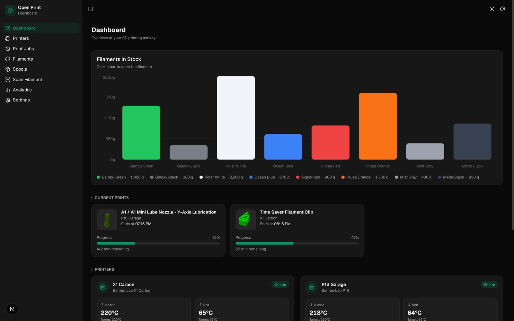
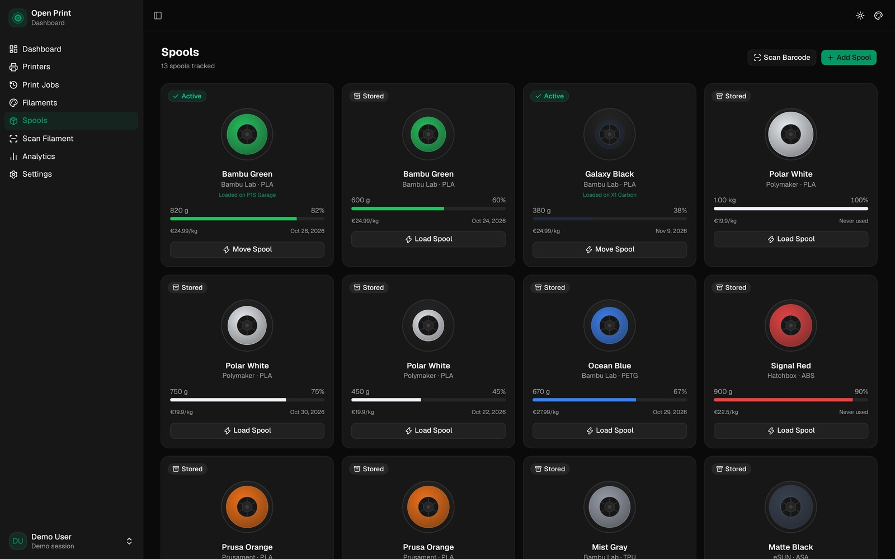
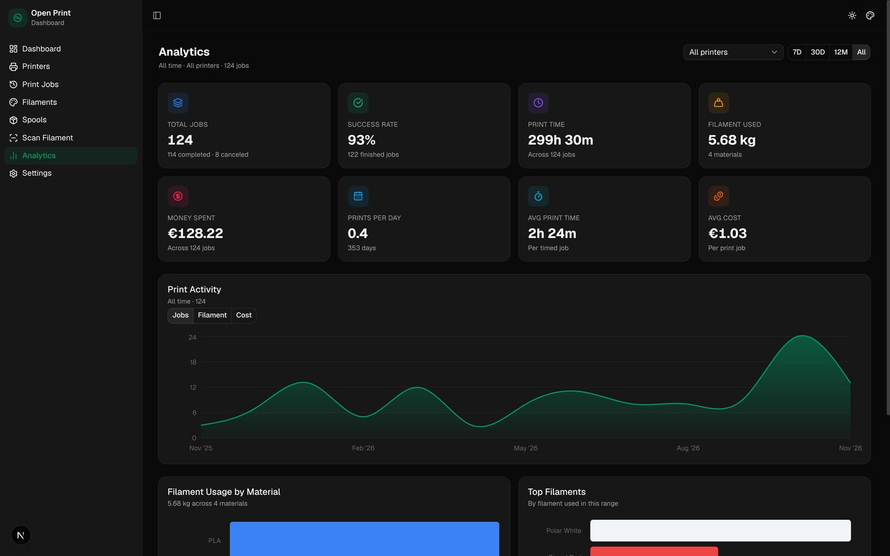
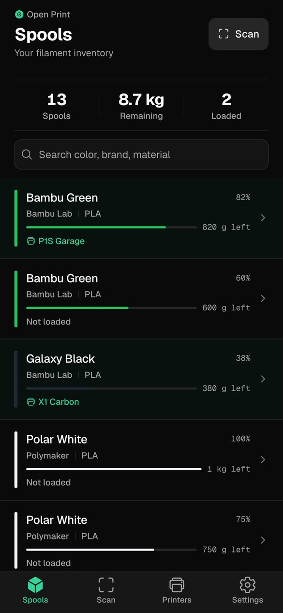
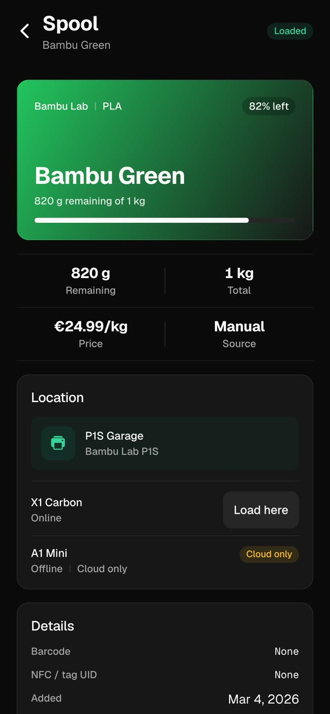
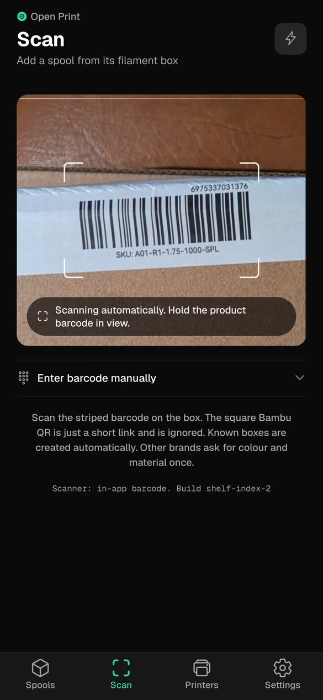

<div align="center">


<h1>OpenPrintDash</h1>

**Every print. Every spool. Your dashboard.**

A self-hosted dashboard for Bambu Lab 3D printers. Live status, filament and
spool inventory, print history and material cost — on your own hardware.

[](https://openprintdash.app)
[](https://demo.openprintdash.app)
[](https://github.com/SchlangeGoto/open-print-dashboard)
[](LICENSE)
[](compose.yml)

[Website](https://openprintdash.app) ·
[Live demo](https://demo.openprintdash.app) ·
[Install](https://openprintdash.app/install/) ·
[Docs](docs) ·
[Issues](https://github.com/SchlangeGoto/open-print-dashboard/issues)

</div>

<p align="center">
  <a href="https://demo.openprintdash.app">
    
  </a>
</p>
<p align="center"><sub>The dashboard with demo data. <a href="https://demo.openprintdash.app">Open the live demo</a>.</sub></p>

## What it does

- **Live printer status** — nozzle and bed temperatures, progress, layers, time remaining, fan and speed.
- **Filament library** — brand, material, colour, temperatures and remaining stock.
- **Spool inventory** — individual rolls, remaining weight, price per kilogram and the printer they are loaded in.
- **Print history and cost** — every job with weight, duration, outcome and material cost.
- **Native scanner** — scan a Bambu box with the iOS or Android app; known barcodes create the spool.
- **One Docker stack** — app, database and migrations in one compose file, with Mailpit available in the development stack.

## Screenshots

| Spools | Analytics |
| :---: | :---: |
|  |  |

### Native companion

The native companion is built with Expo. It scans Bambu box barcodes and reads
the same inventory as the dashboard. The web dashboard stays complete without it.

<p align="center">
  
  
  
</p>

## Self-hosted by default

| Where | What lives there |
| --- | --- |
| **Your server** | The app, PostgreSQL, print history, filaments, spools and costs. |
| **Bambu Cloud** | Account login, printer discovery, and history or covers where cloud sync is used. |
| **Nowhere else** | No analytics, no telemetry, no third-party tracking. |

The app is AGPL-3.0. Bambu Cloud is part of the printer connection, and we
say so plainly. Your dashboard data stays on your hardware.

## Stack

| Layer | Technology |
| --- | --- |
| Web | Next.js 16 · React 19 · TypeScript · Tailwind CSS · shadcn/ui |
| API | FastAPI · Python 3.13 · SQLModel · Pydantic · Alembic |
| Data | PostgreSQL 16 |
| Native | Expo · React Native |
| Deploy | Docker · Docker Compose |
| Printer connection | Bambu Cloud account; current LAN/MQTT client for live status |

## Quick start

You need Docker and Docker Compose, a Bambu Lab printer on your network, and the
printer's IP address, serial number and access code.

```bash
git clone https://github.com/SchlangeGoto/open-print-dashboard.git
cd open-print-dashboard
cp .env.example .env

# Generate a secret and put it in .env
openssl rand -hex 32

docker compose -f compose.prod.yml up -d --build
```

> `compose.yml` is the development stack. Production uses `compose.prod.yml`.
> See [`docs/DEPLOYMENT.md`](docs/DEPLOYMENT.md) for reverse proxy, TLS and
> `NEXT_PUBLIC_API_URL` details.

Open <http://localhost:3000> and follow the setup wizard:

```text
Create account  →  Connect Bambu Lab  →  Add printer
```

> **Just looking?** The [live demo](https://demo.openprintdash.app) runs the real
> dashboard with seeded data and no backend.

### Finding printer credentials

| Value | Where to find it |
| --- | --- |
| **IP address** | Printer touchscreen → Settings → Network → IP address, or your router's DHCP list |
| **Serial number** | Printer touchscreen → Settings → Device → Serial number, or the sticker on the back |
| **Access code** | Printer touchscreen → Settings → Network → Access code; LAN mode must be enabled |

Official guide: [Bambu Lab Wiki — finding the serial number](https://wiki.bambulab.com/en/general/find-sn).

## Configuration

<details>
<summary><strong>Ports and services</strong></summary>

| Service | Port | Description |
| --- | --- | --- |
| Web app | `3000` | Next.js dashboard |
| API | `8000` | FastAPI, with Swagger UI at `/docs` |
| PostgreSQL | `5432` | Database (development stack only; not exposed in production) |

Edit the public port in `compose.prod.yml` if 3000 is already taken.

</details>

## Updating

```bash
git pull
docker compose -f compose.prod.yml up -d --build
```

The database lives in the `postgres_data` Docker volume and survives updates.

## Development

See [`docs/SETUP.md`](docs/SETUP.md) for local setup, database and printer
configuration. API notes are in [`docs/API.md`](docs/API.md).

CI and release automation: [`docs/CI.md`](docs/CI.md). Production Docker
deployment: [`docs/DEPLOYMENT.md`](docs/DEPLOYMENT.md).

## Contributing

Issues and pull requests are welcome. Read
[`CONTRIBUTING.md`](CONTRIBUTING.md), make a focused change, run the relevant
checks, and open a PR with a clear description. Report security issues through
[`SECURITY.md`](SECURITY.md), not a public issue.

Setup, testing and CI notes are in [`docs/SETUP.md`](docs/SETUP.md) and
[`docs/CI.md`](docs/CI.md).

## Managed hosting (beta)

For people who would rather not run Docker, there is a small managed beta at
[openprintdash.app/hosting](https://openprintdash.app/hosting/). It is a
convenience for people who cannot self-host, not a feature gate or the business
model. Self-hosting stays free.

## Support

OpenPrintDash is free and self-hosted. If it saves you time, you can
[sponsor the project on GitHub](https://github.com/sponsors/SchlangeGoto).
Donations cover the demo, the domain and maintenance; self-hosting stays free.

## License

GNU AGPLv3 — see [`LICENSE`](LICENSE). Not affiliated with Bambu Lab.

## Acknowledgements

- MQTT commands adapted from [ha-bambulab](https://github.com/greghesp/ha-bambulab) by greghesp
- Built on top of the unofficial Bambu Lab cloud and MQTT APIs
- Backend structure inspired by the [full-stack-fastapi-template](https://github.com/fastapi/full-stack-fastapi-template)

<div align="center">

Made with ❤️ for the 3D printing community.

⭐ **Star this repo** if it is useful — it helps others find it.

</div>
